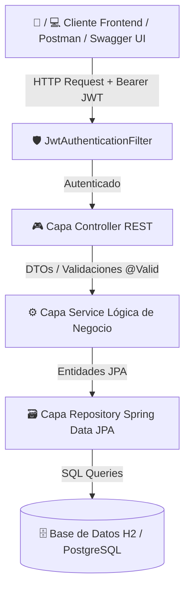
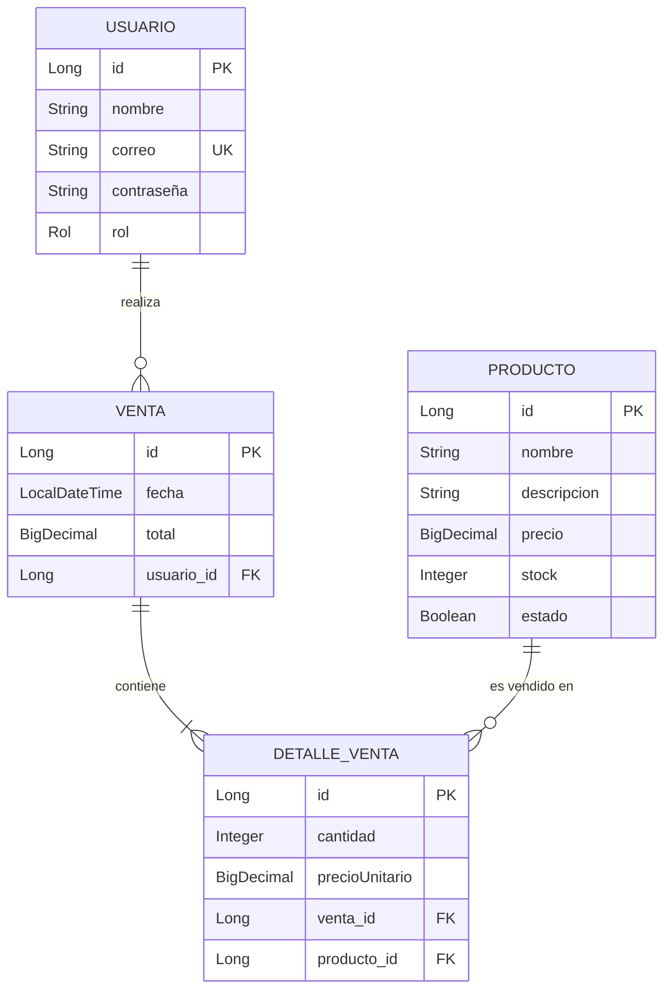

# 🛒 API REST Backend de Gestión de Usuarios, Productos y Ventas


Sistema **API RESTful backend profesional** desarrollado con **Java 21**, **Spring Boot 3** y **Spring Security con JWT (JSON Web Tokens)** para administrar el ciclo completo de usuarios, catálogo de productos tecnológicos y procesamiento transaccional de ventas con control automático de stock.

---

## 🌟 Características Principales

* 🔒 **Autenticación y Seguridad Stateless (JWT)**: Registro de usuarios con hashing BCrypt de contraseñas y autenticación vía Bearer Token JWT.
* 👥 **Control de Acceso Basado en Roles (RBAC)**: Distinción estricta de permisos entre rol `ADMIN` (administrador) y `USER` (cliente final).
* 📦 **Gestión de Productos**: CRUD completo de productos con validación de precios positivos, control de stock y estado de disponibilidad.
* 💳 **Procesamiento de Ventas Transaccionales**:
  * Asociación automática de compras al usuario autenticado extraído del token JWT.
  * Verificación en tiempo real de stock y disponibilidad del producto.
  * Descuento automático de stock de los productos comprados.
  * Cálculo automatizado de subtotales item por item y total de la venta en el backend.
* 📄 **Documentación Interactiva Swagger / OpenAPI 3**: Interfaz visual para probar todos los endpoints directamente desde el navegador con soporte de autenticación Bearer Token.
* 🗄️ **Base de Datos Híbrida (H2 / PostgreSQL)**:
  * Funciona de inmediato sin instalación previa mediante base de datos en memoria **H2**.
  * Soporte nativo y configurable para **PostgreSQL** en entornos de producción.
* 🚦 **Manejo Centralizado de Excepciones**: Respuestas JSON limpias y estructuradas en errores de validación (`400`), credenciales inválidas (`401`), acceso denegado (`403`), recursos no encontrados (`404`) y conflictos (`409`).

---

## 🏗️ Arquitectura del Sistema

El proyecto sigue una **Arquitectura en Capas (Layered Architecture)** para garantizar mantenibilidad, desacoplamiento y escalabilidad:



### 📐 Modelo Entidad-Relación (ERD)



---

## 🛡️ Matriz de Permisos por Rol

| Endpoint | Método | Descripción | ROL ADMIN | ROL USER | PÚBLICO |
| :--- | :---: | :--- | :---: | :---: | :---: |
| `/auth/register` | `POST` | Registro de nuevos usuarios |  |  |  |
| `/auth/login` | `POST` | Inicio de sesión y obtención de JWT |  |  |  |
| `/auth/me` | `GET` | Ver perfil del usuario autenticado |  |  | ❌ |
| `/productos` | `GET` | Listar catálogo de productos |  |  |  |
| `/productos/{id}` | `GET` | Consultar producto específico |  |  |  |
| `/productos` | `POST` | Crear nuevo producto |  | ❌ | ❌ |
| `/productos/{id}` | `PUT` | Actualizar producto |  | ❌ | ❌ |
| `/productos/{id}` | `DELETE` | Eliminar producto |  | ❌ | ❌ |
| `/ventas` | `POST` | Registrar nueva compra |  |  | ❌ |
| `/ventas/mis-ventas` | `GET` | Consultar mis compras |  |  | ❌ |
| `/ventas` | `GET` | Listar todas las ventas globales |  | ❌ | ❌ |
| `/ventas/{id}` | `GET` | Ver detalle de una venta por ID |  |  | ❌ |
| `/usuarios` | `GET` / `POST` | Administrar usuarios |  | ❌ | ❌ |
| `/usuarios/{id}` | `GET` / `DELETE` | Consultar/Eliminar usuario por ID |  | ❌ | ❌ |

---

## 🚀 Guía de Inicio Rápido

### Requisitos Previos

* **Java JDK 17 o 21**
* **Maven 3.8+** (se incluye script de Wrapper `./mvnw`)

### 1. Clonar el repositorio
```bash
git clone https://github.com/tu-usuario/api-gestion-ventas.git
cd api-gestion-ventas
```

### 2. Ejecutar la aplicación
No requiere configurar base de datos previa. La API iniciará utilizando una base de datos **H2 en memoria** con datos de prueba autogenerados:

```bash
# En Windows (PowerShell / Cmd):
.\mvnw spring-boot:run

# En Linux / macOS:
./mvnw spring-boot:run
```

La aplicación iniciará en `http://localhost:8080`.

---

## 🔑 Credenciales Demo Cargadas Inicialmente

Al iniciar por primera vez, el sistema carga automáticamente las siguientes cuentas de prueba:

| Rol | Correo Electrónico | Contraseña | Descripción |
| :--- | :--- | :--- | :--- |
| 👑 **ADMIN** | `admin@techstore.com` | `Admin123!` | Administrador con acceso total al sistema |
| 👤 **USER** | `cliente@techstore.com` | `User123!` | Cliente comprador para realizar compras |
| 👤 **USER** | `maria@techstore.com` | `User123!` | Cliente secundario |

---

## 🌐 Documentación Interactiva & Consola H2

* 📖 **Swagger UI (OpenAPI 3)**: [http://localhost:8080/swagger-ui.html](http://localhost:8080/swagger-ui.html)
  *(Hacer clic en el botón `Authorize` e ingresar el token en formato `Bearer <tu_token_jwt>` para probar endpoints protegidos)*
* 🗄️ **Consola H2 Database**: [http://localhost:8080/h2-console](http://localhost:8080/h2-console)
  * **JDBC URL**: `jdbc:h2:mem:ventasdb`
  * **User Name**: `sa`
  * **Password**: *(dejar en blanco)*

---

## 🧪 Pruebas Unitarias e Integración

Para ejecutar la suite completa de pruebas automáticas con **JUnit 5 y Mockito**:

```bash
./mvnw test
```

---

## 📑 Colección de Postman

Se incluye una colección lista para importar en Postman ubicada en:
[`docs/postman_collection.json`](docs/postman_collection.json)

**Instrucciones**:
1. Abrir Postman e importar el archivo `docs/postman_collection.json`.
2. Ejecutar primero la petición **"Login Admin"** o **"Login Cliente"**.
3. El token JWT se guardará automáticamente en las variables del entorno para autorizar todas las peticiones subsiguientes.

---

## 📂 Estructura del Proyecto

```text
api-gestion-ventas/
├── docs/
│   ├── 00-enunciado/
│   ├── 01-analisis/
│   ├── 02-diseno/
│   └── postman_collection.json
├── src/
│   ├── main/
│   │   ├── java/com/dev/senior/
│   │   │   ├── config/              # Configuración de Seguridad, OpenAPI y Seed Data
│   │   │   ├── controller/          # Controladores REST API
│   │   │   ├── dto/                 # Data Transfer Objects (Requests & Responses)
│   │   │   ├── exception/           # Manejo Global de Excepciones
│   │   │   ├── model/               # Entidades JPA (Usuario, Producto, Venta, DetalleVenta)
│   │   │   ├── repository/          # Repositorios Spring Data JPA
│   │   │   ├── security/            # Servicios JWT y UserDetails
│   │   │   └── service/             # Servicios con Lógica de Negocio
│   │   └── resources/
│   │       └── application.properties
│   └── test/                        # Pruebas unitarias y de integración
├── pom.xml
└── README.md
```

---

## 📝 Licencia

Este proyecto se distribuye bajo la licencia **MIT**. Consulta el archivo `LICENSE` para más detalles.
